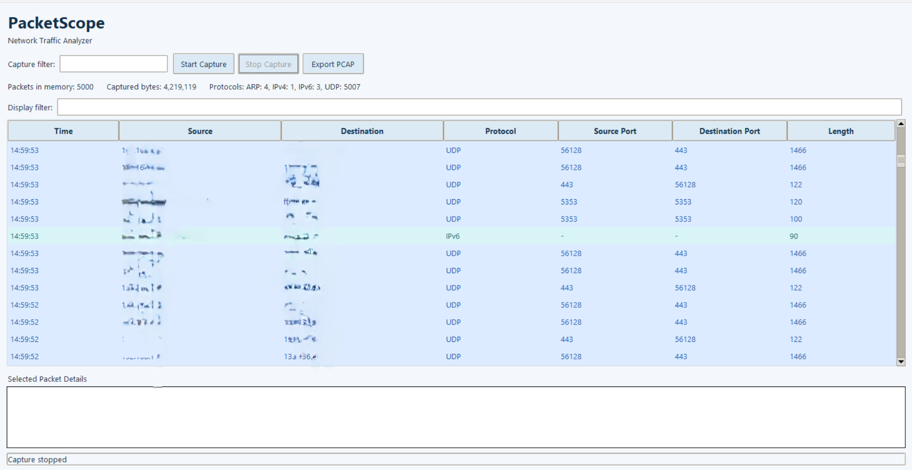

# PacketScope — Network Packet Analyzer

PacketScope is a Python-based network packet analyzer with a graphical user interface built using Tkinter and Scapy. It captures network traffic, displays packet metadata, supports capture and display filtering, and allows users to inspect and export captured packets.

## Features

- Live packet capture using Scapy.
- Graphical interface built with Tkinter.
- Capture filters using BPF syntax.
- Display filters for searching captured packet metadata.
- Packet information including timestamps, source and destination IP addresses, protocols, ports, and packet lengths.
- Selected packet details.
- Protocol statistics and captured-byte counters.
- Bounded in-memory packet storage.
- Export captured packets to PCAP files.

## Technologies

- Python
- Scapy
- Tkinter
- Threading and queues
- PCAP

## Project Structure

```text
PacketScope/
├── packet_sniffer_gui.py
├── packet_sniffer.py
├── requirements.txt
├── .gitignore
├── README.md
└── screenshots/
```

## Installation

1. Install Python 3.
2. Clone the repository:

   ```bash
   git clone https://github.com/YOUR_USERNAME/PacketScope.git
   cd PacketScope
   ```

3. Install the dependencies:

   ```bash
   pip install -r requirements.txt
   ```

4. Install and configure the packet-capture dependencies required by Scapy for your operating system.

## Usage

Run the graphical application:

```bash
python packet_sniffer_gui.py
```

Start capturing packets, optionally enter a capture filter, and use the display filter to search the packets shown in the interface.

### Capture Filter Examples

```text
tcp
udp
icmp
tcp or udp
port 53
```

Capture filters use BPF syntax. The available capture capabilities depend on your operating system, capture backend, and permissions.

## Screenshots

Add screenshots of the application interface and packet details in the `screenshots/` directory.

## Notes

- Packet capture may require administrator or elevated privileges.
- Capture only traffic on networks and systems you own or are authorized to monitor.
- Packet storage is limited in memory; PCAP exports contain the packets retained at export time.



## Author

Amr Shoujaa
